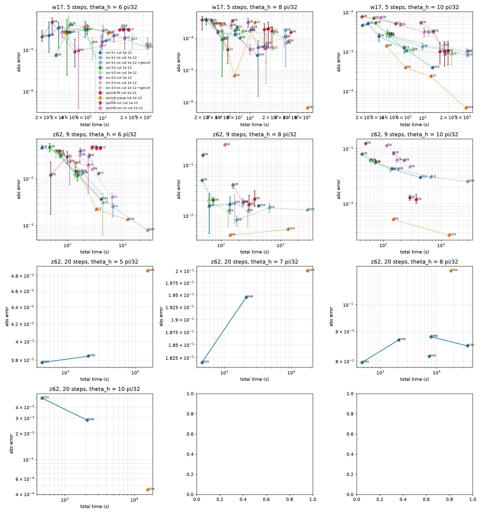

# Kicked Ising: Heisenberg MPO, src-method against quimb

## Provenance

```json
{
 "src_method": "0.5.3.dev12+gd5a04f9a6",
 "quimb": "1.15.0",
 "autoray": "0.11.0",
 "opt_einsum": "3.4.0",
 "numpy": "2.4.4",
 "cupy": "14.2.0",
 "cuda_runtime": 13020,
 "cuda_driver": 13000,
 "gpu": "NVIDIA RTX PRO 6000 Blackwell Server Edition",
 "gpus_visible": 1,
 "qiskit": "2.6.1",
 "qiskit_ibm_runtime": "0.51.0",
 "stim": "1.16.0",
 "python": "3.14.7",
 "host": "computeinstance-e05a79nv5z3datsw3m",
 "slurm_job": null,
 "git": "de8ed02e1dd17871422c99fb7d0a473f00d7a6d3",
 "dtype": "complex128",
 "env": {
  "CUDA_VISIBLE_DEVICES": "4",
  "CUPY_TF32": "0",
  "NVIDIA_TF32_OVERRIDE": "0",
  "CUPY_CUDA_PER_THREAD_DEFAULT_STREAM": null,
  "TMPDIR": "/dev/shm/ki-scratch"
 }
}
```

## Geometry

qiskit_ibm_runtime FakeKyiv (ibm_kyiv, Eagle r3): 127 qubits, 144 edges. Ordering: chain site = qubit label (Kim et al. SI Fig. S9b 'IBM' order). The largest number of gates over one cut is 6, so 6 sub-layers with at most one gate per cut is optimal; Anand et al. used 13. Longest gate: 15 sites.

| sub-layer | gates | U bond | U^dag bond | cuts at bond 2 |
|---|---|---|---|---|
| 0 | 64 | 2 | 2 | 123 |
| 1 | 34 | 2 | 2 | 115 |
| 2 | 15 | 2 | 2 | 106 |
| 3 | 18 | 2 | 2 | 97 |
| 4 | 11 | 2 | 2 | 73 |
| 5 | 2 | 2 | 2 | 30 |

## Checks

Dense operator, 12-qubit heavy hexagon (qubits [0, 1, 2, 3, 4, 14, 15, 18, 19, 20, 21, 22]), 2 sub-layers, theta_h = 0.8876, 2 steps, O = YZYZZIIXXZZI, full bond 4096. qiskit statevector against the dense reference: 6.9e-17.

| method | relative Frobenius error of U^dag O U |
|---|---|
| src-k1 | 2.8e-15 |
| src-k1-os | 5.1e-15 |
| src-k2 | 2.0e-15 |
| src-k2-os | 8.7e-15 |
| src-k3 | 2.0e-15 |
| src-k3-os | 8.7e-15 |
| quimb-fit | 4.9e-15 |
| quimb-zipup | 6.6e-15 |
| quimb-src | 3.8e-15 |
| quimb-src-os | 6.1e-15 |
| quimb-src-default | 3.8e-15 |
| quimb-src-os-default | 6.1e-15 |

Stack order:

- src(Bd, Ad, O, A, B) vs Bd Ad O A B: 1.4e-15
- reversed stack vs Bd Ad O A B: 1.4e+00

16-qubit fragment (qubits [0, 1, 2, 3, 4, 5, 6, 14, 15, 18, 19, 20, 21, 22, 23, 24]), theta_h = 0.5597, 3 steps, O = IZIIZZZZIIZIIIXY, chi = 4096: <0|O|0> against qiskit (-0.057633).

| method | abs error | max bond |
|---|---|---|
| src-k1 | 2.3e-16 | 256 |
| src-k1-os | 3.7e-15 | 256 |
| src-k2 | 6.6e-16 | 256 |
| src-k2-os | 2.7e-16 | 256 |
| src-k3 | 3.7e-16 | 256 |
| src-k3-os | 5.3e-16 | 256 |
| quimb-fit | 1.9e-16 | 256 |
| quimb-zipup | 1.5e-15 | 256 |
| quimb-src | 3.3e-16 | 256 |
| quimb-src-os | 9.5e-16 | 256 |
| quimb-src-default | 3.3e-16 | 256 |
| quimb-src-os-default | 9.5e-16 | 256 |

Clifford points (127 qubits, chi = 16) against stim:

- w10_is_U5_Z13_U5dag: matches the paper's string up to sign: True
- w17_is_U5_Z58_U5dag: matches the paper's string up to sign: True

| case | stim | method | abs error | max bond |
|---|---|---|---|---|
| z62_20steps_k0 | 1 | src-k1 | 4.2e-13 (max over steps 4.2e-13) | 1 |
| z62_20steps_k0 | 1 | src-k1-os | 1.7e-13 (max over steps 1.7e-13) | 1 |
| z62_20steps_k0 | 1 | src-k2 | 2.5e-13 (max over steps 2.5e-13) | 1 |
| z62_20steps_k0 | 1 | src-k3 | 1.9e-13 (max over steps 1.9e-13) | 1 |
| z62_20steps_k0 | 1 | quimb-fit | 2.5e-13 (max over steps 2.5e-13) | 1 |
| z62_20steps_k0 | 1 | quimb-zipup | 3.2e-13 (max over steps 3.2e-13) | 2 |
| z62_20steps_k0 | 1 | quimb-src | 1.1e-12 (max over steps 1.1e-12) | 1 |
| z62_20steps_k0 | 1 | quimb-src-os | 9.1e-13 (max over steps 9.1e-13) | 1 |
| z62_20steps_k16 | 0 | src-k1 | 0.0e+00 | 1 |
| z62_20steps_k16 | 0 | src-k1-os | 0.0e+00 | 1 |
| z62_20steps_k16 | 0 | src-k2 | 0.0e+00 | 1 |
| z62_20steps_k16 | 0 | src-k3 | 0.0e+00 | 1 |
| z62_20steps_k16 | 0 | quimb-fit | 0.0e+00 | 1 |
| z62_20steps_k16 | 0 | quimb-zipup | 0.0e+00 | 2 |
| z62_20steps_k16 | 0 | quimb-src | 0.0e+00 | 1 |
| z62_20steps_k16 | 0 | quimb-src-os | 0.0e+00 | 1 |
| w10_5steps_k16 | 1 | src-k1 | 1.4e-13 | 1 |
| w10_5steps_k16 | 1 | src-k1-os | 9.4e-14 | 1 |
| w10_5steps_k16 | 1 | src-k2 | 7.7e-14 | 1 |
| w10_5steps_k16 | 1 | src-k3 | 6.9e-14 | 1 |
| w10_5steps_k16 | 1 | quimb-fit | 1.3e-13 | 1 |
| w10_5steps_k16 | 1 | quimb-zipup | 1.3e-14 | 2 |
| w10_5steps_k16 | 1 | quimb-src | 2.1e-13 | 1 |
| w10_5steps_k16 | 1 | quimb-src-os | 1.5e-13 | 1 |
| w17_5steps_k16 | -1 | src-k1 | 1.1e-13 | 1 |
| w17_5steps_k16 | -1 | src-k1-os | 6.1e-14 | 1 |
| w17_5steps_k16 | -1 | src-k2 | 7.5e-14 | 1 |
| w17_5steps_k16 | -1 | src-k3 | 7.9e-14 | 1 |
| w17_5steps_k16 | -1 | quimb-fit | 6.7e-14 | 1 |
| w17_5steps_k16 | -1 | quimb-zipup | 2.3e-14 | 2 |
| w17_5steps_k16 | -1 | quimb-src | 1.8e-13 | 1 |
| w17_5steps_k16 | -1 | quimb-src-os | 2.6e-13 | 1 |

## Host SVD failures of src-method

13 of 432 src-method runs without the fallback stopped with `LinAlgError: SVD did not converge` (numpy gesdd on the host, in `truncated_qr` or the oversampled truncation). Rerun with a gesvd fallback, they appear as `+gesvd` in the tables.

| run | step | error |
|---|---|---|
| w10:5:7:src-k1:256:0 | 5 | LinAlgError: SVD did not converge |
| w10:5:9:src-k1:128:0 | 4 | LinAlgError: SVD did not converge |
| w17:5:10:src-k1-os:128:2 | 5 | LinAlgError: SVD did not converge |
| w17:5:10:src-k1-os:512:0 | 5 | LinAlgError: SVD did not converge |
| w17:5:10:src-k1:128:1 | 4 | LinAlgError: SVD did not converge |
| w17:5:10:src-k2-os:128:2 | 5 | LinAlgError: SVD did not converge |
| w17:5:6:src-k1-os:128:1 | 4 | LinAlgError: SVD did not converge |
| w17:5:6:src-k3-os:128:0 | 5 | LinAlgError: SVD did not converge |
| w17:5:6:src-k3-os:512:1 | 4 | LinAlgError: SVD did not converge |
| w17:5:8:src-k1-os:256:0 | 5 | LinAlgError: SVD did not converge |
| z62:9:6:src-k1-os:256:1 | 6 | LinAlgError: SVD did not converge |
| z62:9:6:src-k2-os:256:1 | 6 | LinAlgError: SVD did not converge |
| z62:9:8:src-k3:256:1 | 7 | LinAlgError: SVD did not converge |

## Stage 1: exactly verifiable regime (5 steps, src-k1, seed 0)

w10, complex128: absolute error against BGC exact; `F` marks a failed run (host SVD did not converge), `*` a run with the gesvd fallback.

| theta_h / (pi/32) | exact | chi 128 | chi 256 | chi 384 | chi 512 | chi 1024 |
|---|---|---|---|---|---|---|
| 0 | 0 | 3.1e-78 | 2.9e-78 | 2.5e-78 | 1.6e-78 | 8.2e-78 |
| 1 | -2.48303e-05 | 4.8e-11 | 2.6e-12 | 1.7e-12 | 1.3e-12 | 1.6e-13 |
| 2 | -0.00060111 | 9.9e-08 | 2.8e-10 | 6.9e-12 | 1.4e-12 | 5.0e-15 |
| 3 | -0.00299498 | 2.2e-06 | 4.9e-09 | 1.8e-11 | 8.7e-13 | 3.9e-15 |
| 4 | -0.0077148 | 5.4e-05 | 2.8e-07 | 8.6e-10 | 3.9e-14 | 8.6e-16 |
| 5 | -0.0146206 | 4.9e-05 | 1.2e-05 | 4.2e-09 | 2.0e-16 | 7.2e-16 |
| 6 | -0.0233923 | 6.4e-04 | 3.6e-05 | 4.8e-15 | 7.4e-16 | 3.2e-16 |
| 7 | -0.0281306 | 3.9e-03 | 4.8e-05* | 4.6e-15 | 6.3e-16 | 2.1e-16 |
| 8 | -0.0128409 | 4.6e-03 | 3.8e-04 | 6.5e-15 | 3.1e-15 | 8.0e-16 |
| 9 | 0.0315001 | 8.8e-03* | 1.3e-03 | 1.4e-14 | 1.6e-15 | 1.4e-15 |
| 10 | 0.0943015 | 1.1e-02 | 1.0e-03 | 3.2e-14 | 6.1e-15 | 1.2e-14 |
| 11 | 0.178854 | 2.3e-03 | 1.5e-03 | 3.6e-15 | 6.8e-15 | 8.9e-15 |
| 12 | 0.317475 | 4.6e-03 | 1.1e-03 | 1.6e-14 | 5.0e-15 | 2.3e-14 |
| 13 | 0.521356 | 2.3e-03 | 1.7e-04 | 6.1e-14 | 3.7e-14 | 4.6e-14 |
| 14 | 0.749026 | 6.9e-04 | 7.0e-06 | 3.1e-14 | 5.7e-14 | 4.6e-14 |
| 15 | 0.930311 | 5.8e-05 | 1.0e-08 | 9.7e-10 | 2.9e-14 | 1.7e-14 |
| 16 | 1 | 9.4e-15 | 2.8e-14 | 1.7e-14 | 1.1e-15 | 2.2e-14 |

w10, complex64: absolute error against BGC exact; `F` marks a failed run (host SVD did not converge), `*` a run with the gesvd fallback.

| theta_h / (pi/32) | exact | chi 1024 |
|---|---|---|
| 0 | - | - |
| 1 | - | - |
| 2 | - | - |
| 3 | - | - |
| 4 | - | - |
| 5 | - | - |
| 6 | - | - |
| 7 | - | - |
| 8 | -0.0128409 | 2.9e-06 |
| 9 | - | - |
| 10 | - | - |
| 11 | - | - |
| 12 | - | - |
| 13 | - | - |
| 14 | - | - |
| 15 | - | - |
| 16 | - | - |

w17, complex128: absolute error against BGC exact; `F` marks a failed run (host SVD did not converge), `*` a run with the gesvd fallback.

| theta_h / (pi/32) | exact | chi 128 | chi 256 | chi 512 | chi 1024 |
|---|---|---|---|---|---|
| 0 | -0 | - | 2.3e-140 | 0.0e+00 | 9.6e-141 |
| 1 | 6.14478e-10 | - | 1.7e-12 | 3.1e-13 | 3.0e-14 |
| 2 | 1.22814e-07 | - | 5.7e-10 | 1.8e-10 | 3.0e-10 |
| 3 | 1.0928e-06 | - | 4.4e-08 | 2.2e-08 | 5.4e-09 |
| 4 | 2.93232e-06 | - | 1.5e-07 | 1.3e-06 | 2.0e-07 |
| 5 | 9.65753e-06 | - | 5.7e-06 | 2.9e-06 | 9.9e-07 |
| 6 | 3.05633e-05 | 1.0e-05 | 1.1e-05 | 2.3e-05 | 5.9e-07 |
| 7 | 3.78007e-05 | - | 3.8e-05 | 8.7e-05 | 4.3e-05 |
| 8 | -4.36173e-05 | 4.1e-04 | 1.7e-04 | 1.5e-04 | 2.9e-05 |
| 9 | -0.000862057 | - | 5.3e-04 | 1.7e-04 | 1.2e-04 |
| 10 | -0.00737913 | 5.6e-03 | 2.7e-03 | 1.4e-03 | 4.0e-04 |
| 11 | -0.0385285 | - | 5.7e-03 | 2.6e-03 | 9.1e-04 |
| 12 | -0.133408 | - | 4.7e-03 | 1.5e-03 | 3.1e-05 |
| 13 | -0.330267 | - | 3.4e-03 | 4.0e-04 | 3.7e-04 |
| 14 | -0.615178 | - | 8.4e-04 | 3.0e-04 | 1.2e-04 |
| 15 | -0.886311 | - | 3.8e-05 | 1.2e-05 | 9.4e-07 |
| 16 | -1 | - | 4.5e-14 | 9.4e-14 | 6.3e-14 |

## One compression of U^dag O U (z62:8:6, sub-layer 0, chi 256)

O is the observable evolved by src-k1 at bond 256 (input bond 255); the exact sandwich has bond 1020. Relative Frobenius error of the compressed operator and change of <0|.|0>, mean (min-max) over seeds.

| method | seeds | rel. Frobenius error | value error | seconds |
|---|---|---|---|---|
| svd-optimal | 1 | 0.033 (0.033-0.033) | 1.4e-04 | 16.8 |
| src-k1 | 5 | 0.080 (0.079-0.082) | 4.8e-03 | 2.3 |
| src-k1-os | 5 | 0.051 (0.050-0.051) | 2.0e-03 | 6.0 |
| quimb-src | 5 | 0.187 (0.180-0.203) | 1.3e-02 | 2.3 |
| quimb-src-os | 5 | 0.106 (0.101-0.111) | 9.5e-03 | 5.9 |
| quimb-fit | 5 | 0.116 (0.115-0.116) | 2.1e-03 | 34.9 |
| quimb-zipup | 1 | 0.056 (0.056-0.056) | 1.7e-03 | 12.9 |

## One compression of U^dag O U (z62:8:6, sub-layer 0, chi 64)

O is the observable evolved by src-k1 at bond 64 (input bond 64); the exact sandwich has bond 256. Relative Frobenius error of the compressed operator and change of <0|.|0>, mean (min-max) over seeds.

| method | seeds | rel. Frobenius error | value error | seconds |
|---|---|---|---|---|
| svd-optimal | 1 | 0.048 (0.048-0.048) | 1.6e-03 | 2.0 |
| src-k1 | 5 | 0.115 (0.106-0.121) | 9.3e-03 | 0.5 |
| src-k1-os | 5 | 0.073 (0.071-0.075) | 4.1e-03 | 1.3 |
| quimb-src | 5 | 0.269 (0.209-0.431) | 5.5e-02 | 0.7 |
| quimb-src-os | 5 | 0.151 (0.118-0.212) | 1.7e-02 | 1.5 |
| quimb-fit | 5 | 0.066 (0.066-0.067) | 4.7e-03 | 10.5 |
| quimb-zipup | 1 | 0.080 (0.080-0.080) | 1.8e-03 | 2.1 |

## Cost of one Trotter step at large chi (random saturated operator)

| method | chi | cutoff | dtype | QR | groups done | step s (or partial) | TFLOP | TFLOP/s | GPU pool GB | host peak GB | input GB | tiers (first group) | CholeskyQR tried / fallback / skipped |
|---|---|---|---|---|---|---|---|---|---|---|---|---|---|
| src-k1-g8 | 2048 | 0 | complex64 | library | 6 | 138.8 | 3273.4 | 23.59 | 3.3 | 34 | 15.6 | device: 127 | 270 / 64 / 456 |
| src-k1-g8 | 2048 | 0 | complex64 | Householder on rank 0 | 6 | 131.4 | 3325.1 | 25.31 | 3.0 | 34 | 15.6 | device: 127 | 0 / 0 / 0 |
| src-k1-g8 | 4096 | 0 | complex64 | library | 6 | 410.8 | 26092.1 | 63.52 | 12.7 | 133 | 62.0 | device: 127 | 275 / 66 / 451 |
| src-k1-g8 | 4096 | 0 | complex64 | Householder on rank 0 | 6 | 357.5 | 26513.4 | 74.16 | 12.7 | 130 | 62.0 | device: 127 | 0 / 0 / 0 |
| src-k1-g8 | 8192 | 0 | complex64 | Householder on rank 0 | 6 | 1681.5 | 210713.2 | 125.31 | 47.0 | 512 | 245.1 | device: 127 | 0 / 0 / 0 |

## w17, 5 steps, theta_h = 6 pi/32 = 0.5890

Reference: 3.056326226e-05 (BGC exact)

| method | chi | runs done | s / step | total s | abs error (min-max) | 2^-n Tr O^dag O | bond | peak GB | TFLOP | TFLOP/s | decomp share |
|---|---|---|---|---|---|---|---|---|---|---|---|
| src-k1 cut 1e-12 | 128 | 3/3 | 3.936 | 23.2 | 2.22e-05 (8.72e-06-4.75e-05) | 0.6358 | 128 | 0.1 | 0.3 | 0.01 | 0.07 |
| src-k1 cut 1e-12 | 256 | 3/3 | 3.313 | 30.1 | 3.41e-05 (1.12e-05-4.71e-05) | 0.8608 | 256 | 0.3 | 1.7 | 0.06 | 0.08 |
| src-k1 cut 1e-12 | 512 | 3/3 | 4.064 | 61.9 | 3.08e-05 (2.07e-05-4.88e-05) | 0.9647 | 504 | 1.6 | 13.2 | 0.21 | 0.37 |
| src-k1 cut 1e-12 | 1024 | 1/1 | 3.843 | 128.6 | 5.90e-07 (5.90e-07-5.90e-07) | 0.9946 | 980 | 5.2 | 66.5 | 0.52 | 0.44 |
| src-k1-os cut 1e-12 | 128 | 2/2 | 7.318 | 41.5 | 4.20e-05 (3.80e-05-4.60e-05) | 0.8250 | 128 | 0.1 | 1.6 | 0.04 | 0.51 |
| src-k1-os cut 1e-12 | 256 | 2/2 | 15.228 | 99.9 | 2.90e-05 (1.90e-05-3.90e-05) | 0.9493 | 256 | 0.4 | 10.4 | 0.10 | 0.61 |
| src-k1-os cut 1e-12 | 512 | 3/3 | 52.186 | 334.3 | 1.15e-05 (7.19e-06-1.94e-05) | 0.9904 | 512 | 2.0 | 84.6 | 0.25 | 0.73 |
| src-k1-os cut 1e-12 +gesvd | 128 | 1/1 | 7.242 | 40.7 | 2.60e-05 (2.60e-05-2.60e-05) | 0.8254 | 128 | 0.1 | 1.6 | 0.04 | 0.51 |
| src-k2 cut 1e-12 | 128 | 3/3 | 5.325 | 28.1 | 7.42e-06 (6.84e-06-8.23e-06) | 0.6531 | 128 | 0.3 | 0.5 | 0.02 | 0.03 |
| src-k2 cut 1e-12 | 256 | 3/3 | 6.193 | 37.8 | 2.59e-05 (2.48e-06-5.45e-05) | 0.8708 | 256 | 1.2 | 2.6 | 0.07 | 0.03 |
| src-k2 cut 1e-12 | 512 | 3/3 | 7.500 | 65.3 | 3.05e-05 (2.37e-05-4.19e-05) | 0.9678 | 510 | 5.4 | 15.2 | 0.23 | 0.17 |
| src-k2-os cut 1e-12 | 128 | 3/3 | 8.087 | 39.2 | 3.75e-05 (1.77e-05-6.53e-05) | 0.8232 | 128 | 0.4 | 1.5 | 0.04 | 0.26 |
| src-k2-os cut 1e-12 | 256 | 3/3 | 12.725 | 74.9 | 1.49e-05 (5.87e-06-2.01e-05) | 0.9478 | 256 | 1.3 | 8.9 | 0.12 | 0.36 |
| src-k2-os cut 1e-12 | 512 | 3/3 | 33.092 | 219.1 | 1.80e-05 (1.10e-05-2.23e-05) | 0.9902 | 512 | 5.3 | 63.0 | 0.29 | 0.50 |
| src-k3 cut 1e-12 | 128 | 3/3 | 21.136 | 98.0 | 1.56e-05 (2.22e-06-2.39e-05) | 0.6753 | 128 | 0.9 | 1.0 | 0.01 | 0.01 |
| src-k3 cut 1e-12 | 256 | 3/3 | 26.415 | 133.9 | 2.21e-05 (1.55e-05-2.91e-05) | 0.8788 | 256 | 4.1 | 4.8 | 0.04 | 0.01 |
| src-k3 cut 1e-12 | 512 | 3/3 | 31.903 | 180.4 | 1.92e-05 (6.54e-06-3.72e-05) | 0.9719 | 511 | 14.5 | 24.4 | 0.14 | 0.08 |
| src-k3-os cut 1e-12 | 128 | 2/2 | 26.288 | 114.5 | 2.48e-05 (2.22e-05-2.75e-05) | 0.8153 | 128 | 1.2 | 2.5 | 0.02 | 0.11 |
| src-k3-os cut 1e-12 | 256 | 2/2 | 34.790 | 168.7 | 3.70e-05 (3.15e-05-4.25e-05) | 0.9454 | 256 | 3.7 | 12.6 | 0.07 | 0.17 |
| src-k3-os cut 1e-12 | 512 | 2/2 | 55.946 | 324.7 | 1.36e-05 (1.30e-05-1.41e-05) | 0.9899 | 512 | 18.2 | 73.9 | 0.23 | 0.29 |
| src-k3-os cut 1e-12 +gesvd | 128 | 1/1 | 24.320 | 107.9 | 1.67e-05 (1.67e-05-1.67e-05) | 0.8159 | 128 | 1.1 | 2.5 | 0.02 | 0.11 |
| src-k3-os cut 1e-12 +gesvd | 512 | 1/1 | 55.316 | 325.6 | 1.25e-05 (1.25e-05-1.25e-05) | 0.9901 | 512 | 18.2 | 73.9 | 0.23 | 0.29 |
| quimb-fit cut 1e-12 | 128 | 3/3 | 24.634 | 157.9 | 3.06e-05 (2.99e-05-3.13e-05) | 0.3804 | 128 | 0.2 | 5.6 | 0.04 | 0.82 |
| quimb-fit cut 1e-12 | 256 | 3/3 | 23.590 | 174.3 | 3.05e-05 (3.00e-05-3.12e-05) | 0.3773 | 256 | 0.8 | 16.2 | 0.09 | 0.78 |
| quimb-fit cut 1e-12 | 512 | 3/3 | 26.217 | 200.2 | 3.05e-05 (3.00e-05-3.12e-05) | 0.3776 | 512 | 2.7 | 34.3 | 0.17 | 0.74 |
| quimb-zipup cut 1e-12 | 128 | 1/1 | 3.256 | 35.5 | 2.62e-05 (2.62e-05-2.62e-05) | 0.7844 | 128 | 0.5 | 2.6 | 0.07 | 0.96 |
| quimb-zipup cut 1e-12 | 256 | 1/1 | 3.652 | 60.5 | 3.57e-05 (3.57e-05-3.57e-05) | 0.9147 | 256 | 1.7 | 14.0 | 0.23 | 0.96 |
| quimb-zipup cut 1e-12 | 512 | 1/1 | 3.350 | 115.7 | 2.62e-05 (2.62e-05-2.62e-05) | 0.9772 | 512 | 5.4 | 77.0 | 0.67 | 0.96 |
| quimb-src cut 1e-12 | 128 | 3/3 | 3.425 | 19.2 | 2.09e-05 (1.60e-05-2.93e-05) | 0.5048 | 120 | 0.2 | 0.3 | 0.02 | 0.47 |
| quimb-src cut 1e-12 | 256 | 3/3 | 2.770 | 25.3 | 4.66e-05 (2.29e-05-6.01e-05) | 0.6929 | 233 | 0.6 | 1.6 | 0.06 | 0.56 |
| quimb-src cut 1e-12 | 512 | 3/3 | 3.507 | 46.7 | 8.96e-06 (3.88e-06-1.82e-05) | 0.8824 | 420 | 1.7 | 8.4 | 0.18 | 0.61 |
| quimb-src-os cut 1e-12 | 128 | 3/3 | 4.509 | 33.2 | 2.73e-05 (1.98e-05-3.26e-05) | 0.6546 | 128 | 0.3 | 0.9 | 0.03 | 0.59 |
| quimb-src-os cut 1e-12 | 256 | 3/3 | 4.235 | 51.6 | 9.66e-06 (3.99e-07-2.69e-05) | 0.8696 | 256 | 0.8 | 4.9 | 0.09 | 0.62 |
| quimb-src-os cut 1e-12 | 512 | 3/3 | 3.949 | 94.7 | 1.23e-05 (6.02e-06-2.20e-05) | 0.9618 | 512 | 2.8 | 26.0 | 0.27 | 0.64 |

## w17, 5 steps, theta_h = 8 pi/32 = 0.7854

Reference: -4.36172567e-05 (BGC exact)

| method | chi | runs done | s / step | total s | abs error (min-max) | 2^-n Tr O^dag O | bond | peak GB | TFLOP | TFLOP/s | decomp share |
|---|---|---|---|---|---|---|---|---|---|---|---|
| src-k1 | 256 | 1/1 | 11.840 | 60.0 | 1.70e-04 (1.70e-04-1.70e-04) | 0.3891 | 256 | 0.6 | 32.2 | 0.54 | 0.06 |
| src-k1 cut 1e-12 | 128 | 3/3 | 3.917 | 22.6 | 3.60e-04 (2.57e-04-4.15e-04) | 0.1684 | 128 | 0.1 | 0.3 | 0.02 | 0.07 |
| src-k1 cut 1e-12 | 256 | 3/3 | 3.984 | 33.4 | 1.54e-04 (1.34e-04-1.81e-04) | 0.3885 | 256 | 0.3 | 1.8 | 0.05 | 0.08 |
| src-k1 cut 1e-12 | 512 | 3/3 | 3.881 | 60.5 | 1.28e-04 (1.16e-04-1.47e-04) | 0.6476 | 509 | 1.7 | 13.8 | 0.23 | 0.35 |
| src-k1 cut 1e-12 | 1024 | 1/1 | 3.869 | 127.6 | 2.90e-05 (2.90e-05-2.90e-05) | 0.8620 | 1005 | 5.0 | 67.0 | 0.52 | 0.42 |
| src-k1-os | 256 | 1/1 | 66.787 | 332.2 | 1.75e-04 (1.75e-04-1.75e-04) | 0.5971 | 256 | 1.0 | 67.5 | 0.20 | 0.15 |
| src-k1-os cut 1e-12 | 128 | 3/3 | 7.187 | 40.6 | 9.74e-05 (4.12e-05-1.71e-04) | 0.3488 | 128 | 0.1 | 1.6 | 0.04 | 0.51 |
| src-k1-os cut 1e-12 | 256 | 2/2 | 15.253 | 99.1 | 1.67e-04 (1.50e-04-1.85e-04) | 0.5991 | 256 | 0.4 | 10.4 | 0.11 | 0.61 |
| src-k1-os cut 1e-12 | 512 | 3/3 | 52.959 | 333.5 | 1.10e-04 (1.27e-05-1.72e-04) | 0.8138 | 512 | 2.1 | 82.3 | 0.25 | 0.74 |
| src-k1-os cut 1e-12 +gesvd | 256 | 1/1 | 15.775 | 100.8 | 1.75e-04 (1.75e-04-1.75e-04) | 0.5971 | 256 | 0.4 | 10.4 | 0.10 | 0.61 |
| src-k2 | 256 | 1/1 | 14.656 | 71.4 | 1.01e-04 (1.01e-04-1.01e-04) | 0.4052 | 256 | 2.2 | 49.9 | 0.70 | 0.02 |
| src-k2 cut 1e-12 | 128 | 3/3 | 5.816 | 29.1 | 2.78e-04 (2.24e-04-3.26e-04) | 0.1808 | 128 | 0.3 | 0.5 | 0.02 | 0.03 |
| src-k2 cut 1e-12 | 256 | 3/3 | 6.394 | 38.7 | 8.87e-05 (6.48e-06-1.86e-04) | 0.4037 | 256 | 1.2 | 2.6 | 0.07 | 0.03 |
| src-k2 cut 1e-12 | 512 | 3/3 | 7.406 | 64.4 | 2.15e-04 (1.78e-04-2.43e-04) | 0.6618 | 511 | 4.8 | 16.2 | 0.25 | 0.16 |
| src-k2-os | 256 | 1/1 | 45.344 | 220.7 | 1.44e-04 (1.44e-04-1.44e-04) | 0.5915 | 256 | 3.3 | 92.9 | 0.42 | 0.05 |
| src-k2-os cut 1e-12 | 128 | 3/3 | 7.988 | 37.6 | 2.49e-04 (2.23e-04-2.95e-04) | 0.3499 | 128 | 0.3 | 1.5 | 0.04 | 0.26 |
| src-k2-os cut 1e-12 | 256 | 2/2 | 13.463 | 76.6 | 1.57e-04 (1.35e-04-1.79e-04) | 0.5910 | 256 | 1.3 | 8.9 | 0.12 | 0.36 |
| src-k2-os cut 1e-12 | 512 | 3/3 | 33.871 | 214.8 | 4.79e-05 (4.32e-05-5.55e-05) | 0.8124 | 512 | 5.3 | 59.9 | 0.28 | 0.52 |
| src-k3 | 256 | 1/1 | 32.390 | 158.5 | 5.43e-05 (5.43e-05-5.43e-05) | 0.4163 | 256 | 7.8 | 102.4 | 0.65 | 0.01 |
| src-k3 cut 1e-12 | 128 | 3/3 | 18.998 | 92.8 | 3.08e-04 (2.15e-04-4.14e-04) | 0.1916 | 128 | 0.8 | 1.1 | 0.01 | 0.01 |
| src-k3 cut 1e-12 | 256 | 3/3 | 26.667 | 131.2 | 5.06e-05 (1.54e-06-8.23e-05) | 0.4149 | 256 | 4.4 | 4.9 | 0.04 | 0.01 |
| src-k3 cut 1e-12 | 512 | 3/3 | 29.914 | 172.1 | 4.81e-05 (1.70e-05-6.45e-05) | 0.6830 | 512 | 14.8 | 25.6 | 0.15 | 0.07 |
| src-k3-os | 256 | 1/1 | 69.195 | 336.5 | 6.76e-05 (6.76e-05-6.76e-05) | 0.5794 | 256 | 11.7 | 183.2 | 0.54 | 0.02 |
| src-k3-os cut 1e-12 | 128 | 3/3 | 24.706 | 106.8 | 2.10e-04 (1.97e-04-2.36e-04) | 0.3316 | 128 | 1.2 | 2.5 | 0.02 | 0.11 |
| src-k3-os cut 1e-12 | 256 | 3/3 | 34.951 | 171.7 | 6.69e-05 (3.86e-06-1.29e-04) | 0.5768 | 256 | 3.7 | 12.6 | 0.07 | 0.17 |
| src-k3-os cut 1e-12 | 512 | 3/3 | 55.565 | 315.7 | 1.03e-04 (5.29e-05-1.99e-04) | 0.8079 | 512 | 18.2 | 66.5 | 0.21 | 0.32 |
| quimb-fit | 256 | 1/1 | 81.125 | 398.5 | 1.52e-04 (1.52e-04-1.52e-04) | 0.7286 | 256 | 2.8 | 206.7 | 0.52 | 0.06 |
| quimb-fit cut 1e-12 | 128 | 3/3 | 24.425 | 161.8 | 1.82e-04 (4.34e-05-2.82e-04) | 0.1090 | 128 | 0.2 | 6.4 | 0.04 | 0.82 |
| quimb-fit cut 1e-12 | 256 | 3/3 | 25.708 | 185.0 | 1.95e-04 (5.07e-05-3.17e-04) | 0.1092 | 256 | 0.7 | 18.8 | 0.10 | 0.79 |
| quimb-fit cut 1e-12 | 512 | 3/3 | 23.760 | 209.7 | 1.66e-04 (5.16e-05-2.28e-04) | 0.1079 | 512 | 2.7 | 52.8 | 0.25 | 0.77 |
| quimb-zipup | 256 | 1/1 | 168.148 | 701.2 | 6.65e-07 (6.65e-07-6.65e-07) | 0.5660 | 256 | 8.1 | 256.6 | 0.37 | 0.97 |
| quimb-zipup cut 1e-12 | 128 | 1/1 | 3.847 | 36.3 | 2.74e-04 (2.74e-04-2.74e-04) | 0.3558 | 128 | 0.5 | 2.6 | 0.07 | 0.96 |
| quimb-zipup cut 1e-12 | 256 | 1/1 | 3.236 | 58.9 | 6.62e-06 (6.62e-06-6.62e-06) | 0.5661 | 256 | 1.6 | 13.9 | 0.24 | 0.96 |
| quimb-zipup cut 1e-12 | 512 | 1/1 | 3.616 | 117.5 | 3.02e-04 (3.02e-04-3.02e-04) | 0.7724 | 512 | 5.2 | 78.1 | 0.66 | 0.96 |
| quimb-src | 256 | 1/1 | 11.177 | 54.9 | 3.44e-04 (3.44e-04-3.44e-04) | 0.3330 | 256 | 2.1 | 32.2 | 0.59 | 0.06 |
| quimb-src cut 1e-12 | 128 | 3/3 | 3.299 | 19.6 | 3.65e-04 (1.81e-04-4.81e-04) | 0.1021 | 123 | 0.2 | 0.4 | 0.02 | 0.45 |
| quimb-src cut 1e-12 | 256 | 3/3 | 3.378 | 27.2 | 3.43e-04 (2.76e-04-3.95e-04) | 0.2379 | 243 | 0.6 | 1.8 | 0.07 | 0.53 |
| quimb-src cut 1e-12 | 512 | 3/3 | 3.191 | 46.9 | 4.28e-05 (1.58e-05-9.53e-05) | 0.4444 | 410 | 1.9 | 9.0 | 0.19 | 0.58 |
| quimb-src-os | 256 | 1/1 | 73.498 | 365.1 | 7.92e-05 (7.92e-05-7.92e-05) | 0.5384 | 256 | 4.4 | 90.0 | 0.25 | 0.36 |
| quimb-src-os cut 1e-12 | 128 | 3/3 | 3.582 | 30.9 | 2.76e-04 (2.06e-04-3.14e-04) | 0.1610 | 128 | 0.3 | 1.0 | 0.03 | 0.58 |
| quimb-src-os cut 1e-12 | 256 | 3/3 | 4.252 | 52.4 | 2.44e-04 (1.91e-04-3.04e-04) | 0.3764 | 256 | 0.9 | 5.2 | 0.10 | 0.60 |
| quimb-src-os cut 1e-12 | 512 | 3/3 | 3.832 | 99.2 | 4.31e-05 (3.11e-05-6.39e-05) | 0.6518 | 512 | 3.6 | 28.6 | 0.29 | 0.61 |

## w17, 5 steps, theta_h = 10 pi/32 = 0.9817

Reference: -0.007379132869 (BGC exact)

| method | chi | runs done | s / step | total s | abs error (min-max) | 2^-n Tr O^dag O | bond | peak GB | TFLOP | TFLOP/s | decomp share |
|---|---|---|---|---|---|---|---|---|---|---|---|
| src-k1 cut 1e-12 | 128 | 2/2 | 3.975 | 22.4 | 5.18e-03 (4.78e-03-5.58e-03) | 0.0498 | 128 | 0.1 | 0.4 | 0.02 | 0.07 |
| src-k1 cut 1e-12 | 256 | 3/3 | 3.499 | 30.1 | 2.48e-03 (1.83e-03-2.93e-03) | 0.1402 | 256 | 0.3 | 1.8 | 0.06 | 0.08 |
| src-k1 cut 1e-12 | 512 | 3/3 | 3.819 | 59.9 | 1.25e-03 (9.24e-04-1.42e-03) | 0.2888 | 510 | 1.6 | 13.9 | 0.23 | 0.35 |
| src-k1 cut 1e-12 | 1024 | 1/1 | 4.126 | 130.3 | 3.98e-04 (3.98e-04-3.98e-04) | 0.5295 | 1005 | 5.5 | 68.6 | 0.53 | 0.41 |
| src-k1 cut 1e-12 +gesvd | 128 | 1/1 | 3.195 | 19.2 | 4.63e-03 (4.63e-03-4.63e-03) | 0.0492 | 128 | 0.1 | 0.3 | 0.02 | 0.07 |
| src-k1-os cut 1e-12 | 128 | 2/2 | 7.253 | 40.4 | 2.51e-03 (2.48e-03-2.54e-03) | 0.1258 | 128 | 0.1 | 1.6 | 0.04 | 0.51 |
| src-k1-os cut 1e-12 | 256 | 3/3 | 15.245 | 98.9 | 1.33e-03 (1.11e-03-1.70e-03) | 0.2706 | 256 | 0.4 | 10.4 | 0.11 | 0.61 |
| src-k1-os cut 1e-12 | 512 | 2/2 | 52.684 | 338.4 | 1.02e-03 (9.01e-04-1.13e-03) | 0.4728 | 512 | 2.0 | 84.6 | 0.25 | 0.73 |
| src-k1-os cut 1e-12 +gesvd | 128 | 1/1 | 7.082 | 39.8 | 2.61e-03 (2.61e-03-2.61e-03) | 0.1263 | 128 | 0.1 | 1.6 | 0.04 | 0.51 |
| src-k1-os cut 1e-12 +gesvd | 512 | 1/1 | 52.486 | 338.2 | 8.19e-04 (8.19e-04-8.19e-04) | 0.4754 | 512 | 2.0 | 84.6 | 0.25 | 0.73 |
| src-k2 cut 1e-12 | 128 | 3/3 | 5.353 | 27.5 | 5.37e-03 (5.18e-03-5.47e-03) | 0.0519 | 128 | 0.2 | 0.5 | 0.02 | 0.03 |
| src-k2 cut 1e-12 | 256 | 3/3 | 6.235 | 37.8 | 2.83e-03 (2.32e-03-3.59e-03) | 0.1433 | 256 | 1.0 | 2.6 | 0.07 | 0.03 |
| src-k2 cut 1e-12 | 512 | 3/3 | 7.327 | 64.0 | 1.06e-03 (9.99e-04-1.13e-03) | 0.2991 | 512 | 4.0 | 16.4 | 0.26 | 0.16 |
| src-k2-os cut 1e-12 | 128 | 2/2 | 8.434 | 39.6 | 2.78e-03 (2.19e-03-3.38e-03) | 0.1234 | 128 | 0.3 | 1.6 | 0.04 | 0.26 |
| src-k2-os cut 1e-12 | 256 | 3/3 | 12.975 | 75.7 | 1.11e-03 (9.96e-04-1.32e-03) | 0.2591 | 256 | 1.3 | 8.9 | 0.12 | 0.36 |
| src-k2-os cut 1e-12 | 512 | 3/3 | 33.190 | 219.0 | 8.65e-04 (4.59e-04-1.15e-03) | 0.4679 | 512 | 5.3 | 63.0 | 0.29 | 0.50 |
| src-k2-os cut 1e-12 +gesvd | 128 | 1/1 | 7.749 | 37.6 | 2.67e-03 (2.67e-03-2.67e-03) | 0.1230 | 128 | 0.3 | 1.6 | 0.04 | 0.26 |
| src-k3 cut 1e-12 | 128 | 3/3 | 19.528 | 94.8 | 5.36e-03 (5.04e-03-5.97e-03) | 0.0564 | 128 | 0.7 | 1.1 | 0.01 | 0.01 |
| src-k3 cut 1e-12 | 256 | 3/3 | 26.694 | 133.5 | 3.26e-03 (2.85e-03-3.62e-03) | 0.1429 | 256 | 3.7 | 4.9 | 0.04 | 0.01 |
| src-k3 cut 1e-12 | 512 | 3/3 | 32.645 | 183.8 | 8.71e-04 (8.05e-04-9.04e-04) | 0.3113 | 512 | 14.9 | 25.9 | 0.14 | 0.07 |
| src-k3-os cut 1e-12 | 128 | 3/3 | 27.283 | 117.0 | 3.07e-03 (2.44e-03-3.50e-03) | 0.1118 | 128 | 1.2 | 2.5 | 0.02 | 0.11 |
| src-k3-os cut 1e-12 | 256 | 3/3 | 36.789 | 177.7 | 1.42e-03 (8.19e-04-1.84e-03) | 0.2389 | 256 | 3.7 | 12.6 | 0.07 | 0.17 |
| src-k3-os cut 1e-12 | 512 | 3/3 | 56.003 | 330.1 | 9.90e-04 (8.34e-04-1.22e-03) | 0.4507 | 512 | 18.2 | 73.9 | 0.22 | 0.29 |
| quimb-fit cut 1e-12 | 128 | 3/3 | 26.767 | 159.0 | 1.02e-03 (4.91e-04-1.71e-03) | 0.0648 | 128 | 0.2 | 5.9 | 0.04 | 0.82 |
| quimb-fit cut 1e-12 | 256 | 3/3 | 24.211 | 181.4 | 1.03e-03 (4.36e-04-1.81e-03) | 0.0648 | 256 | 0.6 | 17.1 | 0.09 | 0.79 |
| quimb-fit cut 1e-12 | 512 | 3/3 | 24.597 | 198.5 | 1.04e-03 (4.74e-04-1.81e-03) | 0.0648 | 512 | 1.8 | 34.4 | 0.17 | 0.72 |
| quimb-zipup cut 1e-12 | 128 | 1/1 | 3.537 | 37.1 | 1.40e-03 (1.40e-03-1.40e-03) | 0.1741 | 128 | 0.5 | 2.6 | 0.07 | 0.96 |
| quimb-zipup cut 1e-12 | 256 | 1/1 | 3.557 | 62.6 | 3.95e-04 (3.95e-04-3.95e-04) | 0.3156 | 256 | 1.6 | 14.7 | 0.24 | 0.96 |
| quimb-zipup cut 1e-12 | 512 | 1/1 | 3.493 | 124.8 | 2.38e-04 (2.38e-04-2.38e-04) | 0.5013 | 512 | 5.9 | 84.3 | 0.68 | 0.96 |
| quimb-zipup cut 1e-12 | 1024 | 1/1 | 3.120 | 325.7 | 3.80e-05 (3.80e-05-3.80e-05) | 0.6916 | 1024 | 18.7 | 429.0 | 1.32 | 0.96 |
| quimb-src cut 1e-12 | 128 | 3/3 | 3.153 | 19.0 | 7.70e-03 (7.55e-03-7.95e-03) | 0.0222 | 126 | 0.2 | 0.4 | 0.02 | 0.44 |
| quimb-src cut 1e-12 | 256 | 3/3 | 2.989 | 26.3 | 7.09e-03 (6.77e-03-7.31e-03) | 0.0662 | 244 | 0.7 | 1.8 | 0.07 | 0.52 |
| quimb-src cut 1e-12 | 512 | 3/3 | 3.293 | 47.8 | 5.14e-03 (4.86e-03-5.44e-03) | 0.1526 | 404 | 2.0 | 9.3 | 0.19 | 0.57 |
| quimb-src-os cut 1e-12 | 128 | 3/3 | 3.700 | 31.7 | 7.27e-03 (6.84e-03-7.78e-03) | 0.0331 | 128 | 0.3 | 1.0 | 0.03 | 0.57 |
| quimb-src-os cut 1e-12 | 256 | 3/3 | 4.318 | 54.1 | 4.76e-03 (4.48e-03-5.07e-03) | 0.1112 | 256 | 0.9 | 5.3 | 0.10 | 0.60 |
| quimb-src-os cut 1e-12 | 512 | 3/3 | 3.797 | 103.5 | 3.12e-03 (2.36e-03-3.98e-03) | 0.2923 | 512 | 3.0 | 29.9 | 0.29 | 0.61 |

## z62, 1 steps, theta_h = 8 pi/32 = 0.7854

Reference: none

| method | chi | runs done | s / step | total s | abs error (min-max) | 2^-n Tr O^dag O | bond | peak GB | TFLOP | TFLOP/s | decomp share |
|---|---|---|---|---|---|---|---|---|---|---|---|
| quimb-fit c64 | 1024 | 1/1 | 60.893 | 60.9 | - | nan | 1024 | 18.2 | 1620.6 | 26.61 | 0.07 |

## z62, 9 steps, theta_h = 6 pi/32 = 0.5890

Reference: 0.744222939 (BGC exact)

| method | chi | runs done | s / step | total s | abs error (min-max) | 2^-n Tr O^dag O | bond | peak GB | TFLOP | TFLOP/s | decomp share |
|---|---|---|---|---|---|---|---|---|---|---|---|
| src-k1 cut 1e-12 | 128 | 3/3 | 3.007 | 34.3 | 4.58e-02 (4.24e-02-5.14e-02) | 0.8878 | 128 | 0.1 | 0.8 | 0.02 | 0.06 |
| src-k1 cut 1e-12 | 256 | 3/3 | 3.468 | 61.7 | 3.83e-02 (3.79e-02-3.90e-02) | 0.9399 | 256 | 0.5 | 5.2 | 0.09 | 0.07 |
| src-k1 cut 1e-12 | 512 | 3/3 | 4.028 | 138.1 | 1.40e-02 (1.14e-02-1.85e-02) | 0.9718 | 511 | 1.9 | 42.7 | 0.31 | 0.28 |
| src-k1 cut 1e-12 | 1024 | 1/1 | 4.230 | 406.9 | 3.64e-03 (3.64e-03-3.64e-03) | 0.9884 | 1015 | 10.9 | 273.4 | 0.67 | 0.31 |
| src-k1-os cut 1e-12 | 128 | 3/3 | 6.737 | 70.9 | 3.34e-02 (2.84e-02-3.96e-02) | 0.9454 | 128 | 0.1 | 3.2 | 0.04 | 0.46 |
| src-k1-os cut 1e-12 | 256 | 2/2 | 15.286 | 179.7 | 1.41e-02 (1.23e-02-1.59e-02) | 0.9734 | 256 | 0.6 | 22.7 | 0.13 | 0.51 |
| src-k1-os cut 1e-12 | 512 | 3/3 | 52.115 | 657.1 | 2.50e-03 (1.52e-03-3.00e-03) | 0.9889 | 512 | 2.2 | 197.2 | 0.30 | 0.62 |
| src-k1-os cut 1e-12 | 1024 | 1/1 | 229.303 | 2819.5 | 7.91e-04 (7.91e-04-7.91e-04) | 0.9960 | 1024 | 8.3 | 1432.0 | 0.51 | 0.66 |
| src-k1-os cut 1e-12 +gesvd | 256 | 1/1 | 14.900 | 188.1 | 1.30e-02 (1.30e-02-1.30e-02) | 0.9732 | 256 | 0.6 | 22.7 | 0.12 | 0.51 |
| src-k2 cut 1e-12 | 128 | 3/3 | 4.522 | 47.0 | 4.67e-02 (3.71e-02-5.60e-02) | 0.8901 | 128 | 0.4 | 1.3 | 0.03 | 0.02 |
| src-k2 cut 1e-12 | 256 | 3/3 | 5.096 | 74.0 | 3.05e-02 (2.73e-02-3.23e-02) | 0.9422 | 256 | 2.3 | 8.3 | 0.11 | 0.02 |
| src-k2 cut 1e-12 | 512 | 3/3 | 6.320 | 149.8 | 1.14e-02 (8.95e-03-1.50e-02) | 0.9738 | 511 | 10.8 | 58.0 | 0.39 | 0.11 |
| src-k2-os cut 1e-12 | 128 | 3/3 | 7.166 | 61.8 | 3.65e-02 (2.81e-02-4.07e-02) | 0.9420 | 128 | 0.5 | 3.4 | 0.05 | 0.22 |
| src-k2-os cut 1e-12 | 256 | 2/2 | 12.004 | 134.4 | 1.32e-02 (1.02e-02-1.62e-02) | 0.9714 | 256 | 1.8 | 22.8 | 0.17 | 0.26 |
| src-k2-os cut 1e-12 | 512 | 3/3 | 30.897 | 433.8 | 2.98e-03 (6.17e-04-4.90e-03) | 0.9880 | 512 | 6.9 | 174.4 | 0.40 | 0.36 |
| src-k2-os cut 1e-12 +gesvd | 256 | 1/1 | 12.150 | 134.0 | 1.19e-02 (1.19e-02-1.19e-02) | 0.9716 | 256 | 1.8 | 22.8 | 0.17 | 0.26 |
| src-k3 cut 1e-12 | 128 | 3/3 | 15.220 | 169.7 | 3.82e-02 (3.35e-02-4.47e-02) | 0.8927 | 128 | 1.0 | 2.7 | 0.02 | 0.01 |
| src-k3 cut 1e-12 | 256 | 3/3 | 18.900 | 244.5 | 3.04e-02 (2.77e-02-3.42e-02) | 0.9437 | 256 | 4.9 | 17.1 | 0.07 | 0.01 |
| src-k3 cut 1e-12 | 512 | 3/3 | 21.072 | 364.3 | 1.27e-02 (1.21e-02-1.34e-02) | 0.9748 | 512 | 29.3 | 105.6 | 0.29 | 0.04 |
| src-k3-os cut 1e-12 | 128 | 3/3 | 18.877 | 166.5 | 3.11e-02 (2.39e-02-3.92e-02) | 0.9370 | 128 | 1.4 | 6.0 | 0.04 | 0.08 |
| src-k3-os cut 1e-12 | 256 | 3/3 | 25.190 | 278.2 | 1.57e-02 (1.48e-02-1.65e-02) | 0.9697 | 256 | 5.5 | 37.9 | 0.14 | 0.10 |
| src-k3-os cut 1e-12 | 512 | 2/2 | 45.279 | 642.3 | 3.92e-03 (2.83e-03-5.01e-03) | 0.9871 | 512 | 21.1 | 254.6 | 0.40 | 0.16 |
| quimb-fit cut 1e-12 | 128 | 3/3 | 22.032 | 278.7 | 4.64e-02 (4.20e-02-4.96e-02) | 0.8986 | 128 | 0.2 | 10.0 | 0.04 | 0.82 |
| quimb-fit cut 1e-12 | 256 | 3/3 | 22.032 | 334.0 | 4.45e-02 (4.11e-02-4.83e-02) | 0.9009 | 256 | 0.9 | 39.8 | 0.12 | 0.81 |
| quimb-fit cut 1e-12 | 512 | 3/3 | 21.800 | 395.1 | 4.45e-02 (4.12e-02-4.84e-02) | 0.9010 | 512 | 2.9 | 107.4 | 0.27 | 0.76 |
| quimb-zipup cut 1e-12 | 128 | 1/1 | 4.666 | 69.5 | 3.71e-02 (3.71e-02-3.71e-02) | 0.9577 | 128 | 0.6 | 5.7 | 0.08 | 0.96 |
| quimb-zipup cut 1e-12 | 256 | 1/1 | 3.594 | 139.4 | 2.13e-02 (2.13e-02-2.13e-02) | 0.9773 | 256 | 2.4 | 40.7 | 0.29 | 0.97 |
| quimb-zipup cut 1e-12 | 512 | 1/1 | 3.162 | 329.9 | 2.19e-03 (2.19e-03-2.19e-03) | 0.9903 | 512 | 8.4 | 276.3 | 0.84 | 0.97 |
| quimb-zipup cut 1e-12 | 1024 | 1/1 | 5.561 | 1220.6 | 1.32e-03 (1.32e-03-1.32e-03) | 0.9963 | 1024 | 32.3 | 1916.0 | 1.57 | 0.97 |
| quimb-src cut 1e-12 | 256 | 3/3 | 2.506 | 49.0 | 1.18e-02 (1.71e-03-2.25e-02) | 0.8073 | 225 | 0.7 | 3.8 | 0.08 | 0.48 |
| quimb-src cut 1e-12 | 512 | 3/3 | 2.671 | 98.2 | 2.89e-02 (2.09e-02-3.78e-02) | 0.8728 | 400 | 3.2 | 22.8 | 0.23 | 0.54 |
| quimb-src-os cut 1e-12 | 256 | 3/3 | 3.599 | 109.1 | 2.28e-02 (7.47e-03-3.33e-02) | 0.8772 | 256 | 1.5 | 13.1 | 0.12 | 0.55 |
| quimb-src-os cut 1e-12 | 512 | 3/3 | 3.195 | 235.7 | 1.91e-02 (4.92e-03-2.87e-02) | 0.9296 | 512 | 4.8 | 78.3 | 0.33 | 0.58 |

## z62, 9 steps, theta_h = 8 pi/32 = 0.7854

Reference: 0.4783481359 (BGC exact)

| method | chi | runs done | s / step | total s | abs error (min-max) | 2^-n Tr O^dag O | bond | peak GB | TFLOP | TFLOP/s | decomp share |
|---|---|---|---|---|---|---|---|---|---|---|---|
| src-k1 cut 1e-12 | 256 | 3/3 | 3.263 | 63.2 | 1.56e-02 (4.43e-03-2.72e-02) | 0.4275 | 256 | 0.4 | 5.6 | 0.09 | 0.06 |
| src-k1 cut 1e-12 | 512 | 3/3 | 3.920 | 140.0 | 1.68e-02 (1.09e-02-2.36e-02) | 0.5315 | 512 | 1.8 | 45.4 | 0.32 | 0.27 |
| src-k1 cut 1e-12 | 1024 | 1/1 | 3.608 | 426.3 | 1.56e-02 (1.56e-02-1.56e-02) | 0.6449 | 1024 | 7.9 | 303.0 | 0.71 | 0.28 |
| src-k1-os cut 1e-12 | 256 | 2/2 | 14.868 | 181.4 | 8.11e-03 (6.32e-03-9.90e-03) | 0.5458 | 256 | 0.6 | 22.7 | 0.13 | 0.51 |
| src-k1-os cut 1e-12 | 512 | 2/2 | 51.187 | 650.0 | 1.44e-02 (1.14e-02-1.74e-02) | 0.6524 | 512 | 2.2 | 197.2 | 0.30 | 0.62 |
| src-k1-os cut 1e-12 | 1024 | 1/1 | 229.309 | 2842.4 | 1.29e-02 (1.29e-02-1.29e-02) | 0.7568 | 1024 | 8.2 | 1432.7 | 0.50 | 0.66 |
| src-k2 cut 1e-12 | 128 | 1/1 | 5.046 | 47.5 | 5.02e-02 (5.02e-02-5.02e-02) | 0.3404 | 128 | 0.3 | 1.4 | 0.03 | 0.02 |
| src-k2 cut 1e-12 | 256 | 3/3 | 5.115 | 73.5 | 2.00e-02 (1.70e-02-2.32e-02) | 0.4245 | 256 | 1.7 | 8.9 | 0.12 | 0.02 |
| src-k2-os cut 1e-12 | 128 | 3/3 | 7.104 | 61.3 | 1.99e-02 (1.46e-02-2.49e-02) | 0.4269 | 128 | 0.5 | 3.4 | 0.06 | 0.22 |
| src-k2-os cut 1e-12 | 256 | 3/3 | 11.342 | 130.8 | 1.23e-02 (6.07e-03-1.76e-02) | 0.5237 | 256 | 1.8 | 22.8 | 0.17 | 0.26 |
| src-k3 cut 1e-12 | 128 | 3/3 | 15.251 | 158.3 | 4.03e-02 (3.45e-02-4.33e-02) | 0.3363 | 128 | 1.0 | 2.9 | 0.02 | 0.01 |
| src-k3 cut 1e-12 | 256 | 2/2 | 18.033 | 230.1 | 1.84e-02 (1.50e-02-2.17e-02) | 0.4230 | 256 | 3.6 | 18.1 | 0.08 | 0.01 |
| src-k3 cut 1e-12 +gesvd | 256 | 1/1 | 18.841 | 234.8 | 1.81e-02 (1.81e-02-1.81e-02) | 0.4216 | 256 | 3.6 | 18.0 | 0.08 | 0.01 |
| src-k3-os cut 1e-12 | 128 | 3/3 | 19.665 | 168.8 | 1.80e-02 (7.17e-03-2.68e-02) | 0.4131 | 128 | 1.4 | 6.0 | 0.04 | 0.08 |
| src-k3-os cut 1e-12 | 256 | 2/2 | 26.365 | 278.5 | 1.23e-02 (6.05e-03-1.86e-02) | 0.5133 | 256 | 5.5 | 37.9 | 0.14 | 0.10 |
| quimb-fit cut 1e-12 | 128 | 3/3 | 23.057 | 293.6 | 1.65e-02 (1.16e-02-2.50e-02) | 0.4698 | 128 | 0.2 | 12.6 | 0.04 | 0.83 |
| quimb-fit cut 1e-12 | 256 | 3/3 | 20.854 | 364.9 | 2.13e-02 (1.54e-02-3.10e-02) | 0.4788 | 256 | 0.7 | 52.9 | 0.15 | 0.82 |
| quimb-zipup cut 1e-12 | 256 | 1/1 | 3.177 | 141.8 | 4.11e-03 (4.11e-03-4.11e-03) | 0.6655 | 256 | 2.3 | 43.5 | 0.31 | 0.97 |
| quimb-zipup cut 1e-12 | 1024 | 1/1 | 4.695 | 1332.8 | 5.36e-03 (5.36e-03-5.36e-03) | 0.8301 | 1024 | 33.7 | 2101.9 | 1.58 | 0.97 |
| quimb-src cut 1e-12 | 256 | 3/3 | 2.516 | 49.1 | 1.58e-01 (1.45e-01-1.64e-01) | 0.1644 | 237 | 0.8 | 4.3 | 0.09 | 0.44 |
| quimb-src-os cut 1e-12 | 256 | 3/3 | 3.634 | 114.8 | 2.49e-01 (2.39e-01-2.67e-01) | 0.1598 | 256 | 1.5 | 14.4 | 0.13 | 0.53 |

## z62, 9 steps, theta_h = 10 pi/32 = 0.9817

Reference: 0.1235056072 (BGC exact)

| method | chi | runs done | s / step | total s | abs error (min-max) | 2^-n Tr O^dag O | bond | peak GB | TFLOP | TFLOP/s | decomp share |
|---|---|---|---|---|---|---|---|---|---|---|---|
| src-k1 cut 1e-12 | 256 | 3/3 | 3.168 | 60.2 | 6.11e-02 (5.69e-02-6.48e-02) | 0.0236 | 256 | 0.4 | 5.8 | 0.10 | 0.06 |
| src-k1 cut 1e-12 | 512 | 1/1 | 3.504 | 138.1 | 4.25e-02 (4.25e-02-4.25e-02) | 0.0406 | 511 | 1.4 | 46.7 | 0.34 | 0.26 |
| src-k1 cut 1e-12 | 1024 | 1/1 | 3.370 | 435.7 | 3.00e-02 (3.00e-02-3.00e-02) | 0.0674 | 1024 | 7.7 | 311.9 | 0.72 | 0.28 |
| src-k1-os cut 1e-12 | 128 | 2/2 | 6.961 | 72.5 | 5.53e-02 (5.22e-02-5.84e-02) | 0.0285 | 128 | 0.1 | 3.2 | 0.04 | 0.46 |
| src-k1-os cut 1e-12 | 256 | 3/3 | 14.834 | 180.1 | 4.24e-02 (4.05e-02-4.38e-02) | 0.0438 | 256 | 0.6 | 22.7 | 0.13 | 0.51 |
| src-k1-os cut 1e-12 | 512 | 1/1 | 52.105 | 663.3 | 3.03e-02 (3.03e-02-3.03e-02) | 0.0671 | 512 | 2.2 | 197.2 | 0.30 | 0.62 |
| src-k1-os cut 1e-12 | 1024 | 1/1 | 228.940 | 2856.3 | 2.52e-02 (2.52e-02-2.52e-02) | 0.1060 | 1024 | 8.2 | 1432.7 | 0.50 | 0.66 |
| src-k2 cut 1e-12 | 128 | 3/3 | 4.650 | 42.5 | 7.91e-02 (7.74e-02-8.12e-02) | 0.0119 | 128 | 0.3 | 1.4 | 0.03 | 0.02 |
| src-k2 cut 1e-12 | 256 | 3/3 | 5.704 | 72.8 | 5.65e-02 (5.60e-02-5.73e-02) | 0.0240 | 256 | 1.5 | 9.3 | 0.13 | 0.02 |
| src-k2-os cut 1e-12 | 128 | 3/3 | 7.145 | 61.9 | 5.88e-02 (5.72e-02-5.97e-02) | 0.0233 | 128 | 0.5 | 3.4 | 0.05 | 0.22 |
| src-k2-os cut 1e-12 | 256 | 3/3 | 12.024 | 133.2 | 4.09e-02 (3.78e-02-4.36e-02) | 0.0391 | 256 | 1.8 | 22.8 | 0.17 | 0.26 |
| src-k3 cut 1e-12 | 128 | 3/3 | 15.082 | 149.2 | 8.26e-02 (7.58e-02-8.75e-02) | 0.0096 | 128 | 1.0 | 2.9 | 0.02 | 0.01 |
| src-k3 cut 1e-12 | 256 | 3/3 | 18.813 | 229.1 | 6.10e-02 (5.99e-02-6.16e-02) | 0.0229 | 256 | 3.8 | 18.5 | 0.08 | 0.01 |
| src-k3-os cut 1e-12 | 128 | 3/3 | 20.163 | 169.6 | 6.13e-02 (5.57e-02-6.73e-02) | 0.0209 | 128 | 1.4 | 6.0 | 0.04 | 0.08 |
| src-k3-os cut 1e-12 | 256 | 3/3 | 27.888 | 285.6 | 4.62e-02 (4.41e-02-4.83e-02) | 0.0365 | 256 | 5.5 | 37.9 | 0.13 | 0.10 |
| quimb-fit cut 1e-12 | 128 | 2/2 | 20.782 | 285.3 | 1.29e-02 (1.15e-02-1.43e-02) | 0.0832 | 128 | 0.2 | 13.7 | 0.05 | 0.83 |
| quimb-fit cut 1e-12 | 256 | 3/3 | 22.975 | 371.2 | 1.18e-02 (1.01e-02-1.47e-02) | 0.0830 | 256 | 0.8 | 55.6 | 0.15 | 0.82 |
| quimb-zipup cut 1e-12 | 256 | 1/1 | 3.578 | 147.9 | 5.17e-03 (5.17e-03-5.17e-03) | 0.1478 | 256 | 2.5 | 45.0 | 0.30 | 0.97 |
| quimb-zipup cut 1e-12 | 1024 | 1/1 | 5.454 | 1372.8 | 2.68e-03 (2.68e-03-2.68e-03) | 0.2558 | 1024 | 34.2 | 2161.5 | 1.57 | 0.97 |
| quimb-src cut 1e-12 | 256 | 3/3 | 2.502 | 49.4 | 1.23e-01 (1.23e-01-1.24e-01) | 0.0000 | 244 | 0.9 | 4.7 | 0.10 | 0.41 |
| quimb-src-os cut 1e-12 | 256 | 1/1 | 3.538 | 113.8 | 1.13e-01 (1.13e-01-1.13e-01) | 0.0013 | 256 | 1.4 | 14.2 | 0.12 | 0.54 |

## z62, 20 steps, theta_h = 5 pi/32 = 0.4909

Reference: 0.7970058322 (BGC MIX)

| method | chi | runs done | s / step | total s | abs error (min-max) | 2^-n Tr O^dag O | bond | peak GB | TFLOP | TFLOP/s | decomp share |
|---|---|---|---|---|---|---|---|---|---|---|---|
| src-k1 c64 | 1024 | 1/1 | 23.190 | 462.7 | 3.77e-02 (3.77e-02-3.77e-02) | 0.9568 | 1024 | 4.7 | 8343.9 | 18.03 | 0.05 |
| src-k1 c64 | 2048 | 1/1 | 106.214 | 2116.8 | 3.84e-02 (3.84e-02-3.84e-02) | 0.9724 | 2048 | 18.8 | 66296.0 | 31.32 | 0.05 |
| quimb-zipup | 1024 | 0/1 | 1173.630 | - | - (OOM at step 3) | - | - | 87.8 | 3477.0 | 1.48 | 0.97 |
| quimb-zipup | 2048 | 0/1 | 89.005 | - | - (OOM at step 2) | - | - | 17.3 | 123.3 | 1.39 | 0.96 |
| quimb-zipup cut 1e-12 | 1024 | 1/1 | 851.489 | 14977.2 | 4.86e-02 (4.86e-02-4.86e-02) | 0.9822 | 1024 | 79.1 | 27364.6 | 1.83 | 0.97 |
| quimb-zipup cut 1e-12 | 2048 | 0/1 | 2.684 | - | - (OOM at step 9) | - | - | 58.3 | 3559.2 | 1.99 | 0.96 |

## z62, 20 steps, theta_h = 7 pi/32 = 0.6872

Reference: 0.5110455155 (BGC MIX)

| method | chi | runs done | s / step | total s | abs error (min-max) | 2^-n Tr O^dag O | bond | peak GB | TFLOP | TFLOP/s | decomp share |
|---|---|---|---|---|---|---|---|---|---|---|---|
| src-k1 c64 | 1024 | 1/1 | 23.220 | 463.5 | 1.82e-01 (1.82e-01-1.82e-01) | 0.4298 | 1024 | 4.7 | 8343.9 | 18.00 | 0.05 |
| src-k1 c64 | 2048 | 1/1 | 106.116 | 2115.1 | 1.94e-01 (1.94e-01-1.94e-01) | 0.4774 | 2048 | 18.8 | 66296.0 | 31.34 | 0.05 |
| quimb-zipup | 1024 | 0/1 | 1187.709 | - | - (OOM at step 3) | - | - | 87.7 | 3477.0 | 1.46 | 0.97 |
| quimb-zipup | 2048 | 0/1 | 90.316 | - | - (OOM at step 2) | - | - | 17.3 | 123.3 | 1.37 | 0.96 |
| quimb-zipup cut 1e-12 | 1024 | 1/1 | 968.517 | 17377.0 | 2.00e-01 (2.00e-01-2.00e-01) | 0.5799 | 1024 | 88.4 | 31151.3 | 1.79 | 0.97 |
| quimb-zipup cut 1e-12 | 2048 | 0/1 | 2.739 | - | - (OOM at step 9) | - | - | 72.6 | 4992.7 | 2.00 | 0.96 |

## z62, 20 steps, theta_h = 8 pi/32 = 0.7854

Reference: 0.2685871422 (BGC MIX)

| method | chi | runs done | s / step | total s | abs error (min-max) | 2^-n Tr O^dag O | bond | peak GB | TFLOP | TFLOP/s | decomp share |
|---|---|---|---|---|---|---|---|---|---|---|---|
| src-k1 | 1024 | 1/1 | 372.026 | 7384.4 | 8.15e-02 (8.15e-02-8.15e-02) | 0.1350 | 1024 | 9.4 | 8343.9 | 1.13 | 0.05 |
| src-k1 c64 | 1024 | 1/1 | 23.547 | 470.0 | 7.96e-02 (7.96e-02-7.96e-02) | 0.1356 | 1024 | 4.7 | 8343.9 | 17.75 | 0.05 |
| src-k1 c64 | 2048 | 1/1 | 105.512 | 2102.1 | 8.70e-02 (8.70e-02-8.70e-02) | 0.1527 | 2048 | 18.8 | 66296.0 | 31.54 | 0.05 |
| src-k1-g8 c64 | 4096 | 0/1 | 418.356 | - | - | - | - | 13.0 | 261881.3 | 62.71 | 0.06 |
| src-k1-g8 householder c64 | 4096 | 1/1 | 403.839 | 7897.0 | 8.81e-02 (8.81e-02-8.81e-02) | 0.1728 | 4096 | 13.0 | 528935.0 | 66.98 | 0.05 |
| src-k1-g8 householder c64 | 8192 | 1/1 | 1776.389 | 35061.9 | 8.50e-02 (8.50e-02-8.50e-02) | 0.1989 | 8192 | 49.2 | 4208594.7 | 120.03 | 0.05 |
| quimb-zipup | 1024 | 0/1 | 1185.188 | - | - (OOM at step 3) | - | - | 87.7 | 3477.0 | 1.47 | 0.97 |
| quimb-zipup | 2048 | 0/1 | 90.373 | - | - (OOM at step 2) | - | - | 18.7 | 123.3 | 1.36 | 0.96 |
| quimb-zipup cut 1e-12 | 1024 | 1/1 | 1009.276 | 17742.6 | 1.14e-01 (1.14e-01-1.14e-01) | 0.2206 | 1024 | 86.5 | 31100.0 | 1.75 | 0.97 |
| quimb-zipup cut 1e-12 | 2048 | 0/1 | 2.715 | - | - (OOM at step 9) | - | - | 76.4 | 5196.6 | 1.99 | 0.96 |

## z62, 20 steps, theta_h = 10 pi/32 = 0.9817

Reference: 0.01626447216 (BGC MIX)

| method | chi | runs done | s / step | total s | abs error (min-max) | 2^-n Tr O^dag O | bond | peak GB | TFLOP | TFLOP/s | decomp share |
|---|---|---|---|---|---|---|---|---|---|---|---|
| src-k1 c64 | 1024 | 1/1 | 23.605 | 471.3 | 5.07e-03 (5.07e-03-5.07e-03) | 0.0012 | 1024 | 4.7 | 8343.9 | 17.70 | 0.05 |
| src-k1 c64 | 2048 | 1/1 | 105.499 | 2101.8 | 2.83e-03 (2.83e-03-2.83e-03) | 0.0018 | 2048 | 18.8 | 66296.0 | 31.54 | 0.05 |
| quimb-zipup | 1024 | 0/1 | 1186.914 | - | - (OOM at step 3) | - | - | 87.8 | 3477.0 | 1.46 | 0.97 |
| quimb-zipup | 2048 | 0/1 | 89.233 | - | - (OOM at step 2) | - | - | 17.3 | 123.3 | 1.38 | 0.96 |
| quimb-zipup cut 1e-12 | 1024 | 1/1 | 1012.937 | 15445.9 | 4.48e-04 (4.48e-04-4.48e-04) | 0.0041 | 1024 | 65.5 | 26483.9 | 1.71 | 0.97 |
| quimb-zipup cut 1e-12 | 2048 | 0/1 | 2.885 | - | - (OOM at step 9) | - | - | 84.5 | 5488.1 | 1.94 | 0.96 |

## Time against error



## Conclusion (Nebius: stages 1-3)

Every Leonardo run, redone on one Nebius node, then stage 3 extended to `chi`
4096 and 8192.

- **Node.** 8x RTX PRO 6000 Blackwell Server Edition (97.9 GB each), on PCIe with
  no NVLink. GPUs 0-3 sit on NUMA node 0 and GPUs 4-7 on NUMA node 1. The node has
  192 cores and 1.7 TB of RAM. Details are in `node/`.
- **Library.** src-method is PR #85 (`feat/distributed-qr`, 0.5.3.dev12) unchanged;
  `git diff origin/feat/distributed-qr -- src/` is empty. quimb is 1.15 with
  autoray 0.11, on the same GPU.
- **Precision.** Stages 1 and 2 ran in complex128. Stage 3 ran in complex64, except
  the complex128 cross-check.
- **Job layout.** Single-GPU jobs ran 8 at a time, one per GPU, each pinned to 24
  cores of its GPU's NUMA node (`driver.py`). Multi-GPU runs had the node to
  themselves.

Labels in the tables: `c64` is complex64, and a label without it is complex128.
`cut 1e-12` is the truncation cutoff, and no `cut` means cutoff 0. `+gesvd` is the
bench-side SVD fallback. `householder` is the distributed CholeskyQR disabled (see
below). `-g8` is 8 GPUs.

**Bottom line.**

- **Correct, and the same as Leonardo.** The checks reproduce dense, statevector,
  stim and the published exact references to 1e-13-1e-16, as on Leonardo.
  - 553 complex128 runs finished on both machines. Among those with errors above
    1e-11, 10 differ by more than 25%; they are listed below.
  - No run gave NaN in complex128.
- **On this node complex128 is slow, complex64 is fast.**
  - A complex128 GEMM runs at 1.5 TFLOP/s, a complex64 one at 75-82 TFLOP/s.
  - Stages 1 and 2 (complex128, one GPU per run) took 1.3-2.65x longer than on a
    Leonardo A100 (medians per method).
  - Stage 3 in complex64 took 2.8x (`chi = 1024`) and 3.2x (`chi = 2048`) less time
    than complex128 on an A100.
- **complex64 moves the stage 3 value far less than its error.** On `z62:20:8:src-k1:1024`,
  complex64 and complex128 differ by 1.9e-3 in `<Z62>`. Both errors against the
  reference are about 0.08. The Nebius and Leonardo complex128 values differ by
  8.9e-4.
- **`chi = 8192` fits on one node.** 20 steps took 9.7 h on 8 GPUs, using 49 GB of
  each GPU's memory pool, a 916 GB host peak and no disk.
- **The 20-step `<Z62>` error does not fall with `chi` at `theta_h = 8pi/32`.**
  Against the MIX reference it is 0.0796, 0.0870, 0.0881 and 0.0850 at `chi` 1024,
  2048, 4096 and 8192. At 9 steps, where an exact value exists, the same runs are
  at 5.3e-3 (`chi` 4096) and 3.6e-3 (8192). The MIX method itself is within 1.7e-4
  of exact there.
- **The distributed CholeskyQR of PR #85 never accepted a sketch of the real
  complex64 evolution.** It declined 66 of 66 attempts per step at `chi = 4096`.
  The final `chi` 4096 and 8192 runs therefore use Householder QR on rank 0. See
  `cholesky_qr.md`.
- **quimb in complex64 fails on 127 sites.** Fit returns NaN after one step at
  `chi = 1024`. Zip-up spent 1661 s in its warm-up step (about 6 s in complex128),
  and its first timed step had not finished after about 2.5 h, so it was killed.
- **Tensor cores do not speed up complex64 here.** TF32 and BF16x9 give the same
  bits and the same speed as FP32. FP64 emulation is accurate (2-4e-15) and makes
  complex128 GEMMs 11-26x faster, but whole runs only 1.00-1.46x faster.

### Decisions that differ from the brief

- **Stage 2 in complex128**, at the user's request, so that it compares
  one-to-one with Leonardo. Stage 3 is complex64 as briefed, with the complex128
  cross-check of `z62:20:8:src-k1:1024:0`.
- **Native FP64, not emulated,** for every complex128 run. The emulation runs are
  separate, in `fp64-emulation/runs/`, and appear in no table of the summary.
- **The `chi = 4096` run with CholeskyQR stopped at step 10** under the brief's
  stop rule ("CholeskyQR falling back at every site"). Its 10 steps are in
  `runs/` (the `src-k1-g8 c64` row, 0/1 done).
  - It was rerun with `run --householder`, a bench-side patch of
    `src_method._sweep.DISTRIBUTED_QR_MIN` added for this purpose, the same patch
    the QR A/B probes use.
  - The two runs agree bit for bit on steps 1-10.
  - `chi = 8192` ran with `--householder` from the start.
- **The gate on the `chi = 4096` probe** checked CholeskyQR fallbacks in
  aggregate (66 of 275 tried) and passed. Per group, 4 of the 6 groups declined
  every site they tried. That was the first sign of the problem above.
- **`chi = 8192` at `theta_h = 8pi/32` only,** for its cost.
- **The complex64 zip-up evidence run** (`z62:1:8:quimb-zipup:1024:0`) was
  killed; its empty run file was removed. The fit run (NaN) is the `z62, 1 steps`
  section.

### Comparison with Leonardo (complex128, one GPU per run)

Time on Nebius over time on Leonardo, per run, for runs finished on both:

| method | median ratio | total Nebius / Leonardo |
|---|---|---|
| quimb-fit | 1.30 | 3.24 h / 2.65 h |
| quimb-src | 1.38 | 0.45 h / 0.34 h |
| quimb-src-os | 1.56 | 0.98 h / 0.67 h |
| quimb-zipup | 1.68 | 1.77 h / 1.00 h |
| src-k1 | 1.52 | 4.44 h / 2.23 h |
| src-k1-os | 1.70 | 3.46 h / 2.03 h |
| src-k2 | 1.52 | 0.74 h / 0.54 h |
| src-k2-os | 2.02 | 1.67 h / 1.01 h |
| src-k3 | 1.97 | 2.35 h / 1.85 h |
| src-k3-os | 2.65 | 2.79 h / 1.89 h |

The 10 runs whose errors differ by more than 25% (errors above 1e-11):

- `w17:5:8:quimb-zipup:256:0`, with and without cutoff. The two machines reach
  either 6.6e-7 or 6e-6, swapped between cutoff 0 and cutoff 1e-12 (Nebius 6.6e-7
  and 6.6e-6, Leonardo 5.8e-6 and 6.7e-7).
- Randomized methods, within the seed scatter of the same cell:
  - `w17:5:8:src-k1-os:128`, seeds 1 and 2;
  - `z62:9:6:quimb-src(-os):256`, four runs;
  - `z62:9:8:src-k1-os:256:0` and `src-k2-os:256:1`.

**Runs that finished here but not on Leonardo, 16 in all.**
- Four 20-step zip-up runs at `chi = 1024` with cutoff 1e-12.
- Two 9-step src-k1-os runs at `chi = 1024`; Leonardo stopped them on its
  30-minute limit.
- Ten runs that failed or were cut off on Leonardo.

**Host SVD failures.** `LinAlgError: SVD did not converge` stopped 13 of 432
src-method runs: 2 in stage 1 and 11 in stage 2. They are listed in the summary
and kept in `runs_failed/`.
- The failing configurations differ from Leonardo's 11.
- All 13 finished when rerun with the gesvd fallback (`+gesvd`).

### Stage 1 and the precision probe

- **weight-10:** exact (1e-13-1e-16) from `chi = 384` at every angle, as on
  Leonardo.
- **weight-17:** within 1.2e-4 at `chi = 1024`, except `theta_h = 10pi/32` and
  `11pi/32` (4.0e-4 and 9.1e-4).
- **Precision probe** (`w10:5:8:src-k1:1024`, cutoff 1e-12): error 8.0e-16 in
  complex128 and 2.9e-6 in complex64.

### GEMM modes (`gemm_probe.py`, `gemm_probe.json`)

Complex GEMM on one GPU. The error is relative to a pedantic complex128 product.

| mode | 2048^3 | 8192^3 | 65536 x 2048 x 2048 | error |
|---|---|---|---|---|
| complex64, FP32 | 74.9 TFLOP/s | 80.4 TFLOP/s | 79.9 TFLOP/s | 5e-7 to 1e-6 |
| complex64, TF32 (CuPy compute type) | 75.0 | 81.6 | 81.1 | same bits as FP32 |
| complex64, BF16x9 (`CUBLAS_EMULATE_SINGLE_PRECISION`) | 74.9 | 81.7 | 82.0 | same bits as FP32 |
| complex128, FP64 | 1.5 | 1.5 | 1.5 | 0 |
| complex128, emulated (`CUBLAS_EMULATE_DOUBLE_PRECISION`) | 16.6 | 38.5 | 27.6 | 2.1e-15 to 4.3e-15 |

The `eager` emulation strategy gives the same numbers.

FP64 emulation on whole complex128 runs (`fp64-emulation/runs/` against
`runs/`, seed 0):

| run | native | emulated | error, native / emulated |
|---|---|---|---|
| `w10:5:8:src-k1:1024`, cut 1e-12 | 34.2 s | 31.1 s | 8.0e-16 / 2.0e-15 |
| `z62:9:8:quimb-zipup:256`, cut 1e-12 | 141.8 s | 141.5 s | 4.11e-3 / 4.11e-3 |
| `z62:9:8:src-k1-os:512`, cut 1e-12 | 652.0 s | 637.2 s | 1.137e-2 / 1.137e-2 |
| `z62:9:8:src-k1:1024`, cut 1e-12 | 426.3 s | 291.2 s | 1.558e-2 / 1.558e-2 |

### Stage 3: 20-step `<Z62>`, cutoff 0 unless stated

Error against Begušić, Gray and Chan's MIX values (`reference/bgc/mix.csv`).
The bench docstring states their error as below 0.01. Their 9-step MIX values
are within 8e-4 of exact at every angle (1.7e-4 at `8pi/32`). The Leonardo
column is complex128 on one A100.

| `theta_h` | MIX | src-k1, 1024 | src-k1, 2048 | src-k1-g8, 4096 | src-k1-g8, 8192 | zip-up cut 1e-12, 1024 | Leonardo src-k1, 1024 / 2048 |
|---|---|---|---|---|---|---|---|
| `5pi/32` | 0.7970 | 0.0377 | 0.0384 | - | - | 0.0486 | 0.0374 / 0.0393 |
| `7pi/32` | 0.5110 | 0.1816 | 0.1945 | - | - | 0.2000 | 0.1804 / 0.1917 |
| `8pi/32` | 0.2686 | 0.0796 | 0.0870 | 0.0881 | 0.0850 | 0.1143 | 0.0806 / 0.0847 |
| `10pi/32` | 0.0163 | 5.07e-3 | 2.83e-3 | - | - | 4.48e-4 | 5.52e-3 / 3.25e-3 |

- **Precision.** All src-method entries are complex64. Zip-up is complex128,
  since complex64 zip-up does not run (above).
- **Cross-check at `8pi/32`, `chi = 1024`.** complex128 on Nebius gives 0.18709
  (error 0.0815) in 7384 s. complex64 gives 0.18903 in 470 s, and Leonardo
  0.18797 in 1333 s.
- **`chi` 4096 and 8192 step by step.** They agree to about 1e-5 up to step 7.
  From step 8 to 16 the `chi = 8192` value is the higher one, by up to 0.019
  (step 12). From step 17 to 19 it is the lower one, and at step 20 it is 0.003
  higher.
- **quimb zip-up:**
  - At cutoff 0 it runs out of GPU memory at step 3 (`chi = 1024`) and step 2
    (`chi = 2048`), at every angle.
  - At cutoff 1e-12 and `chi = 2048` it runs out at step 9.
  - At cutoff 1e-12 and `chi = 1024` it completes 20 steps in 14977-17743 s,
    with 65-88 GB of GPU memory. On Leonardo's 64 GB A100s it ran out at steps
    13-16 at `5pi/32`, `7pi/32` and `8pi/32`. At `10pi/32` it was stopped by the
    job time limit at step 16.

### Cost of stage 3, measured on whole runs

| run | GPUs | s / step (median) | 20 steps | GPU pool / device | host peak |
|---|---|---|---|---|---|
| src-k1, 1024, complex128 | 1 | 372 | 7384 s | 9.4 GB | 32 GB |
| src-k1, 1024, complex64 | 1 | 23.5 | 470 s | 4.7 GB | 13 GB |
| src-k1, 2048, complex64 | 1 | 105.5 | 2102 s | 18.8 GB | 49 GB |
| src-k1-g8, 4096, complex64, Householder | 8 | 404 | 7897 s | 13.0 GB | 212 GB |
| src-k1-g8, 4096, complex64, CholeskyQR | 8 | 418 | stopped at step 10 | 13.0 GB | 211 GB |
| src-k1-g8, 8192, complex64, Householder | 8 | 1776 | 35062 s | 49.2 GB | 916 GB |
| Leonardo src-k1, 1024, complex128 | 1 A100 | 67 | 1333 s | | |
| Leonardo src-k1, 2048, complex128 | 1 A100 | 342 | 6772 s | | |

**Step probes** (`probe/`). Each probe times one step of a random operator at the
saturated bond.

| `chi` | CholeskyQR | Householder |
|---|---|---|
| 2048 | 138.8 s | 131.4 s |
| 4096 | 410.8 s | 357.5 s |
| 8192 | - | 1681.5 s |

- **Where CholeskyQR was accepted, it was slower.** At `chi = 4096`, groups 0
  and 1 accepted most sites, and their right-to-left sweeps took 88.4 s and
  66.6 s, against 54.3 s and 53.9 s with Householder.
- **No disk anywhere.** No probe or run used the disk tier.
- **Real runs against probes.** At `chi = 4096` the real run's steps were 13%
  slower than the probe's; at `chi = 8192` they were 6% slower (1776 s against
  1681.5 s).

### Caveats

- **Shared host.** Single-GPU runs shared the node 8 ways (host memory, and
  NUMA-local cores per GPU), so host-side work may have contended. Multi-GPU runs
  had the node to themselves.
- **Warm-up.** As on Leonardo, each method got one untimed warm-up step.
- **Environment.** quimb on CuPy 14 needs autoray 0.11. `prek`'s uv hooks
  reinstall the locked 0.8.10, so reinstall 0.11 after running prek.
- **Flops.** Counted as on Leonardo: complex64 and complex128 count the same
  nominal flops.
- **Provenance.** The provenance block in the summary is that of one run. Every
  run file carries its own (dtype, GPUs, environment variables).
- **Logs.** Driver logs are in `logs/`. The per-run logs (`s1-*`, `s2-*`, `fb-*`,
  `s3-*`) are not committed, because of their size.
